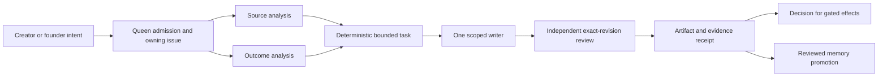

# Arcanea delivery team and creator journey

Status: proposed internal operating map for [programme 276](https://github.com/frankxai/arcanea-ai-app/issues/276).
The existing Queen/SIS remains the coordinating authority. This document creates
no agent process, scheduler, memory store, model rail, public offer or release approval.

The first coherent creator journey is an approved story worth reading, a
source-linked scene, an editable interpretation, a useful image and a private
creation that reopens and exports. Academy lessons and a consented community
showcase can reuse that work. Compare this journey with an ebook, a separate media
tool and files in a folder on the same task: accepted output, continuity errors,
repair effort, time, cost and recovery. Competitive advantage remains unproved.

## Delivery order and capacity

[Programme 276](https://github.com/frankxai/arcanea-ai-app/issues/276) prioritizes
worlds, audience and releases: at least 60% of programme capacity, at most 30% for
enabling Studio Intelligence, and at most 10% for Academy, external tooling and
open-source extraction. This is its planning constraint, not measured allocation
or an implemented scheduler. A new founder decision can change the priorities;
this document does not silently replace them with platform-first work.

1. Creative direction and Product select the existing manuscript/release scope
   through 277. Continuity, editorial and rights review produce a chapter worth
   reading and a traceable source for 278/279/280. Preserve the chosen manuscript;
   a missing selection is a dependency, not permission to invent a new book.
2. Engineering and AI systems carry that source into the existing reader and
   workspace lanes, 454/505. Prove passage selection, a useful interpretation,
   inspected provider output, private save/reopen/export and account denial.
   Quality verifies the exact candidate and actual receiving deployment.
3. Audience and Creative direction prepare a consented excerpt or showcase from
   the accepted artifact. A bounded learner trial adds feedback and moderation.
   Measure completed work and return use before widening the community offer.
4. Extract a developer kit, additional app surface or paid offer after repeated
   useful delivery establishes what creators need. Commerce proves entitlement,
   checkout, delivery/refund and contribution margin in its existing lanes.

The lead records the dependency, accountable seat, artifact, reviewer and next
bounded action on the existing issue. Research should answer a decision in this
chain, such as continuity, provider quality or audience fit. Maintenance repairs
active creator failures within their route's lane. Durable-memory work on 284
supports these missions through the existing SIS/Queen authorities and the
reviewed runtime decision described below.

## Accountable seats and specialists

These eight seats are responsibilities. A bounded mission has one lead and one
writer; it does not require eight resident processes. Existing executive decision
rights and repository gates remain in force.

| Seat                  | Existing capabilities to select                  | Accountable result                                                        |
| --------------------- | ------------------------------------------------ | ------------------------------------------------------------------------- |
| Queen / orchestration | Existing Queen, Starlight Orchestrator           | Owner issue, admission, scope, budget, stop condition and receipt         |
| Product direction     | Navigator, exec-ceo                              | Creator job, priorities and an explicit decision about what waits         |
| Engineering           | Architect, exec-cto, corps-engineering           | Maintained auth, workspace, continuity, recovery and export               |
| AI systems            | exec-caio                                        | Source-verified provider/model choice, evaluations, credentials and costs |
| Creative direction    | Weaver, Luminor, Master Story Architect          | Strong world, character and manuscript work; reviewable canon proposals   |
| Memory / knowledge    | Sage, exec-cio, steward-memory                   | Provenance, contradictions, freshness and permission-scoped recall        |
| Quality / reliability | Sentinel, corps-reliability                      | Exact-revision review, denial/recovery evidence and incident repair       |
| Audience / commercial | exec-cmo, Publishing Strategist, steward-revenue | Reader evidence, approved offers, delivery and contribution margin        |

Books use Character Psychologist, Continuity Guardian, Developmental Editor,
Line Editor & Voice Alchemist, Research Librarian and Sensitivity Reader when
their independent work is useful. Worlds use World Architect and Fantasy & Sci-Fi
Master. Design uses corps-design, accessibility-auditor and performance-guardian.
Research uses the existing Research Architect/scouts; media uses existing art,
music and Motion Design Studio capabilities. Installed names do not establish
available capacity, a running worker or a passing result.

Use the Luminor Engineering Kernel and an explicit available model for each
Apex/Senior/Mechanical/External task. Keep one lead for ordinary work. For a
release-affecting mission, use the repo's admitted 3–5 role team and independent
verifier where required. Machine policy governs actual concurrency; stop only
session-owned workers, servers and watchers. No swarm is admitted in this slice.

## Nine missions with existing ownership

| Mission                        | Existing issue / lane                                  | Acceptance artifact                                                           |
| ------------------------------ | ------------------------------------------------------ | ----------------------------------------------------------------------------- |
| World and book releases        | 277/279/280; canon 278, safety 283                     | Approved chapter/edition, continuity review, rights and reader delivery       |
| Reading and visualization      | 454; candidate PR560                                   | Real source scene, accepted image, private save/reopen/export and isolation   |
| Creator workspace and chat     | 505; history 447; candidate PR562                      | Useful reply/creation, preserved work, selected provider and recovery         |
| Media direction and production | 531/532                                                | Inspected shots, soundtrack, playable export, rights and failure recovery     |
| Academy and community          | Programme 276 until its existing sub-owner is resolved | Learner artifact, feedback, consented share, moderation and access/revocation |
| Developer tools and kits       | 517; integrated PR558 source                           | Fresh install, real task/export, permissions, license and supported version   |
| Product maintenance            | Programme 276 and each affected route's owner          | Reproduced incident, scoped repair, exact checks and receiving deployment     |
| Commerce and economics         | 511/529                                                | Approved offer, checkout/delivery/refund, metering and contribution margin    |
| Durable missions and memory    | 284                                                    | Permission-scoped context, typed edges, resumable execution and write-back    |

Avoid overlapping occupied lanes. Missing ownership is a routing gap to resolve
on 276, not permission to create another queue or control-center product.

## Graph engineering and memory

A mission carries actor/project authority, source revision/hash, input contract,
allowed files/tools, budget, cancellation and acceptance. Validate each edge at
the receiving boundary. Keep fanout for independent work, deterministic reduction
for aggregation, and a different actor for review. Refuse unknown authorization,
missing evidence, exhausted budgets or unapproved publication. Dollar ceilings
must bind actual provider usage; graph cost units do not establish that control.

The private routing candidate passed six bounded component checks on 10 October,
recorded in [programme 276's verification summary](https://github.com/frankxai/arcanea-ai-app/issues/276#issuecomment-6101122593).
They used integrity-verified published `@starlight-intelligence/system` 8.5.1:
graph compilation, required
write-back/distinct reviewer, turn/cost/action brakes, deterministic code reduction,
source/export integrity and supplied RAM/storage/effort/gist denials. No package
was installed or mission dispatched. Payload schemas, durable execution, dollar
enforcement and all nine mission acceptance results remain pending with 284.

Before implementing 284, reconcile its Temporal contract with the later
[reported Vercel/Cloudflare workflow guidance](https://github.com/frankxai/arcanea-ai-app/issues/276#issuecomment-5952149833).
The owner records an explicit retain, migrate or defer decision for each process.
Those references identify a pending runtime decision; they grant no authority to
install a replacement scheduler or infer that an Arcanea worker is already live.

Working context belongs to the session; durable checkpoints belong to the existing
execution runtime. Events belong to private append-only operational records.
Reviewed stable facts enter existing SIS/local-core memory with provenance,
privacy, retention, freshness and contradiction handling. Skills/instructions are
versioned procedural memory. Code and world graphs are derived views. Keep official
canon, founder memory and each user's workspace separate; retrieve through the
current actor's permissions. A cancelled or rejected draft cannot become canon
or stable memory merely because an agent produced it.

## Product stack and recovery

Reuse Vercel, the installed AI SDK and the current Supabase boundary. Provider/media
and SDK upgrades belong to 531 and need current official guidance and comparative
evidence. A second Agents SDK/ADK adapter earns its place through a real task; no
new framework or model name is a quality guarantee.

The proposed creation chain retains source passage/version, scene interpretation,
request identity, provider/model, rights, edits and export references. Generation,
storage, credits and entitlements must recover the same request rather than create
duplicates after a lost acknowledgment. Real provider cancellation/charges, private
media and account/key-storage isolation still need their owners' acceptance.

Infinite-canvas work reuses projects and reader/creator ownership (454/505), with
portable graph state and stable source/creation IDs. Prove restoration, large-world
performance and editing conflicts before separate desktop/mobile products. A native
shell needs a measured offline, camera/audio or device job and cross-device recovery.
API/MCP delivery needs authenticated permissions, quotas, metering, refusal and a
developer who completes a task; local protocol checks alone do not establish that.

Maintenance monitors source-bound deploy health, login return, private save/reopen,
provider timeouts, denial behavior, cost/refunds, dependencies and support incidents.
Use ordinary customer credentials in bounded fixtures, preserve failed artifacts
and test retry/interruption. Document-only checks cannot establish product completion.

## Reader, learner and community adoption

An approved chapter or social excerpt introduces a seeker to the world. A reader
can interpret a scene and keep a private creation. A learner completes a lesson
with feedback and a portable artifact. A creator returns to build a continuing
project and may explicitly share selected work. Proposed mentor/community roles
need actual moderation, permissions and participation evidence.

Circle is a community candidate, not a proven enrollment/payment integration.
Define accessible lessons, moderation/reporting, private versus shared work,
invitation/enrollment, entitlement delivery and revocation after cancellation or
refund. Require consent before reuse in social posts or showcases. Measure completed
artifacts, return visits, repair effort and useful feedback before expanding offers.
Live posting, external sends and premium founder publication retain human gates.

## Books, media, developer IP and revenue

Books need manuscript/continuity/editorial review, an approved release, usable
reading/export formats and buyer delivery. Media starts from approved story beats,
shot continuity and music rights, then inspected clips and a playable export.
Authorized public workflows can inform original Arcanea/GenCreator implementation.
Do not use Higgsfield MCP/skills under Frank's current instruction. Other provider
or software names in a plan do not establish a working integration.

Separate generic developer interfaces from licensed canon/material packs, internal
orchestration and user data. [SKILLS.md](../../SKILLS.md) records current source and
distribution limitations. A kit graduates after an accepted internal task, fresh
consumer installation, outside creator completion/export, rights review and release
approval. Missing root LICENSE text and per-package MIT metadata require an
artifact-specific decision; this proposal assigns no new license or legal terms.

| Income stream                | Useful offer to prove                        | Evidence before a priced launch                                 |
| ---------------------------- | -------------------------------------------- | --------------------------------------------------------------- |
| Books / editions             | Released ebook, print or illustrated edition | Approved text/rights, checkout, delivery/refund and reader use  |
| Art / shop                   | Approved digital collection or print         | Rights, inspected quality, fulfillment/refund and margin        |
| Academy / community          | Course/cohort producing an accepted artifact | Completion, feedback, moderation, entitlements and consent      |
| Hosted workspace             | Durable continuity and production workflow   | Isolation, recovery, return use and support cost                |
| Skills / plugins / team kits | Portable workflow with useful outputs        | Install, licenses, evaluation, compatibility and external reuse |
| API / MCP                    | Supported creator integration                | Auth, quotas/metering, refusal/recovery and developer success   |
| Studio delivery              | Bounded creative production                  | Scope/rights, accepted output, delivery and review cost         |

Keep BYOK inference and subscription value clear. Hosted credits use 529's ledger
and entitlements; packaging must define whether BYOK consumes credits. Proposed
prices, revenue shares and margins remain hypotheses. Measure net receipts after
payment/refund costs, inference, delivery/storage and variable support; record
founder review time separately. Smart contracts/collectibles remain optional work
with a demonstrated buyer job and their legal, security, testnet and spend gates.

## Present evidence and next delivery

Chat PR562 (`86a412ef`) passed native build/typecheck/lint/security and four-mode
synthetic recovery with 12 inspected captures. Reader PR560 (`e6691535`) has actual
disposable Auth/private-save evidence with synthetic image output. Both remain
held for their own current-source independent review and customer/provider gates.
Earlier Worlds PR561 review does not approve the changed Worlds surfaces in PR564.

The full founder objective remains open. Use the existing issues to complete
current review and actual scene/provider/economics acceptance, then carry that
accepted artifact into a lesson and consented showcase. This operating proposal
itself needs independent review before adoption. It is supporting documentation,
not a substitute for released stories, useful creator work or paid customer success.
