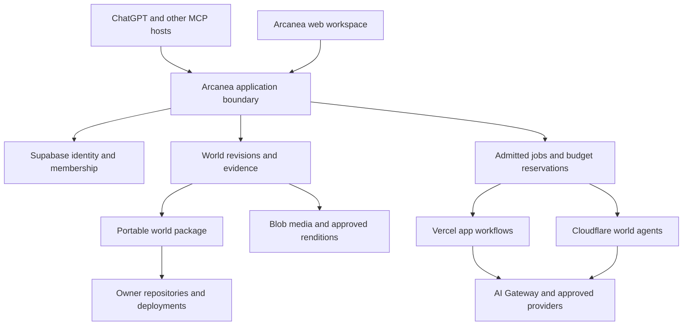

# Arcanea World Platform

30 October 2026 · implementation programme under [#276](https://github.com/frankxai/arcanea-ai-app/issues/276), [#283](https://github.com/frankxai/arcanea-ai-app/issues/283), [#517](https://github.com/frankxai/arcanea-ai-app/issues/517) and [#642](https://github.com/frankxai/arcanea-ai-app/issues/642).

**Product decision: the world is the durable product; a chat, model, avatar, editor or cloud account is one way to work with it.** A creator should be able to begin in ChatGPT, refine in Arcanea, generate a consistent character sheet, publish to an owned website, and continue with another agent without rebuilding context or surrendering ownership.

This document defines the full target and a bounded implementation. Unless explicitly identified as observed or implemented, capabilities and allowances below are proposals. It does not activate subscriptions, grant creative-IP rights, publish a plugin or certify production readiness.

## 1. Starting evidence

| Surface              | Observed on this date                                                                                                                                                                                                                            | Remaining proof                                                                                                                |
| -------------------- | ------------------------------------------------------------------------------------------------------------------------------------------------------------------------------------------------------------------------------------------------ | ------------------------------------------------------------------------------------------------------------------------------ |
| Product source       | `frankxai/arcanea-ai-app`, main `d2929ecd3245eacdf4911d12582296305dc348e9`                                                                                                                                                                       | Required checks and independent review for every new revision                                                                  |
| Production           | Vercel deployment `dpl_4vGqMUzX8veXX9AEMaVNBYfh7DGf`, READY, same source SHA; `arcanea.ai` is among its aliases                                                                                                                                  | Authenticated creator journey, managed-provider execution and billing settlement                                               |
| Public smoke         | `/api/health` returns 200, healthy/live/ready with public data ready; `/worlds` returns 200                                                                                                                                                      | HTTP success does not prove browser usability or retained private work                                                         |
| Supabase             | Existing Arcanea project ACTIVE_HEALTHY, `eu-central-1`, Postgres 17                                                                                                                                                                             | Tenant/recovery test and scoped security disposition                                                                           |
| Data already present | `worlds`, `world_collaborators`, `world_characters`, `world_locations`, `world_factions`, `world_events`, `world_creations`, `world_forks`, `asset_metadata`, `project_docs`, `project_doc_versions`, `credit_transactions`, `platform_api_keys` | Reconcile schema contracts; do not build a second database                                                                     |
| Cloudflare           | Existing `arcanea-reader`, shared `starlight-cloud-worker`, fleet and execution workers observed                                                                                                                                                 | No dedicated world-agent worker observed; existing shared-worker capability is not established by its name                     |
| Vercel Connect       | Arcanea project connector lookup returned 404 `Connector Project not found`                                                                                                                                                                      | Project access/setup and an actual per-user authorization roundtrip                                                            |
| Supabase advisors    | One INFO: RLS without policies for `reader_illustration_requests`; WARN on two callable SECURITY DEFINER functions and leaked-password protection disabled                                                                                       | Inspect intended call paths before changing grants; use existing [#242](https://github.com/frankxai/arcanea-ai-app/issues/242) |
| MCP                  | Local server, graph tools and hosted World Context Gateway source already exist                                                                                                                                                                  | Local tools are not automatically exposed by the hosted gateway; authenticated private reads/writes need separate proof        |

Portfolio architecture was read through the authorized connection. Registry main observed at `d98f814ccafe8b6ab4d87d42360a78a07bf4d41b`; relevant files carry independent blob revisions in the session evidence. The projected `registry/projections/AGENT_BRIEF.md` returned 404, so actual architecture decisions were read. No new runtime was admitted from a stale projection. The repository's generated company block and current portfolio strategy disagree about legal entity naming; public legal copy must be reconciled under #661, not inferred from that block.

## 2. Experiences worth paying for

### Create a world from ChatGPT

The creator connects Arcanea through an authenticated MCP plugin, chooses or creates a private world, and says: “Build a coastal civilization around a walking archive; retain these references and show contradictions before adding lore.” The agent reads the world's current context, proposes entities and relationships, and returns a reviewable change set. Accepting that change set creates a new revision. Generating art produces candidates with source and prompt metadata. Publication remains a separate action against an explicit destination.

The useful result is a saved world the creator can reopen, inspect and export. Conversation length, agent count and image count are not success metrics. Revoke the connector and the world must remain usable through the website and export.

### Build in the website

Extend `/worlds`, `/worlds/[slug]`, the current studio and reader. The world workspace has six views: **Overview, Atlas, Codex, Creations, Timeline and Activity**. These are views of one world revision. A mobile user captures a note, approves a character proposal or checks a render; desktop supports graph editing, multi-asset review and publishing. Avoid creating separate products for each view.

First session: choose an original-world template → name the world → import permitted Markdown or start with a seed → create one location and two inhabitants → inspect continuity → save → export. Empty, loading, denied, provider-failed and disconnected states retain the draft. Keyboard navigation and reduced motion are acceptance requirements, not polish after launch.

### Read into creation

Select a passage in the existing reader → preserve book/chapter/selection offsets and source revision → propose a scene → select the world's approved visual specification → quote the generation cost → generate → review → save as a versioned asset. The original sentence never silently becomes a changed canon fact. A later manuscript edit marks dependent scenes as needing review.

### Bring a world to an owned domain

Select a static world-site template and an approved release snapshot. Preview the exact site and assets. Authorize the chosen GitHub repository and Vercel or Cloudflare project. Deployment returns a receipt containing source commit, destination, deployed version and rollback reference. The creator pays their provider directly in the owner-account mode. Arcanea-hosted publishing is separately metered and capped.

### Continue with another agent

A new agent reads `world.arcanea.json`, its pinned context, canon and visual rules, then obtains only the tools the owner granted. The agent can distinguish accepted facts, proposals, disputed material and retcons. It can ask for a new capability; a character biography or SOUL.md never grants one.

## 3. Architecture and ownership

| Boundary                                                               | Decision                                                                   | Reason / exit route                                                                                                   |
| ---------------------------------------------------------------------- | -------------------------------------------------------------------------- | --------------------------------------------------------------------------------------------------------------------- |
| Website, reader, editor, API                                           | Existing Next.js app on Vercel                                             | Retain deployed product and design system; domain logic stays in portable packages                                    |
| Identity, memberships, entitlements, canonical managed-world revisions | Existing Supabase/Postgres                                                 | Transactions and RLS; versioned logical export and restore                                                            |
| Persistent world actor                                                 | Cloudflare Agent + Durable Object when an addressable actor is needed      | Coordination, subscriptions and resumable entity-local state; business truth remains in Postgres                      |
| Durable cross-service world mission                                    | Existing qualified Cloudflare workflow owner                               | One mission has one orchestrator; never mirror retries across Vercel and Cloudflare                                   |
| App-local compilation/render job                                       | Vercel Workflow; isolated Sandbox for generated code                       | Fits the application release boundary; sandbox has no ambient user secrets                                            |
| Model calls                                                            | Current AI SDK through the existing AI Gateway                             | Choose allowed routes by modality, privacy, quality and budget; log actual provider/model                             |
| Delegated provider access                                              | Vercel Connect candidate for Vercel workloads                              | Server derives subject from verified identity; trusted installation mapping, narrow scopes, expiry and revoke         |
| New web binaries                                                       | Vercel Blob + Image under accepted media policy                            | Approved immutable renditions; private originals require authorized delivery                                          |
| R2                                                                     | Owner-supplied storage adapter or measured platform workload exception     | Appropriate for some large archives/non-Vercel distribution; no universal migration or duplicate canonical asset lake |
| GitHub                                                                 | Versioned code, canon/specification packages, templates, release manifests | One chosen source authority; explicit commit and change review                                                        |
| Google Drive                                                           | Import source, private masters, review and recovery copies                 | No production page should depend on a Drive sharing link                                                              |
| Notion                                                                 | Editorial workspace and human projection                                   | Reconcile revisions; never treat every projection as a write master                                                   |
| Semantic retrieval                                                     | SQL/lexical/typed graph first, optional embeddings as a derived index      | Rebuildable indexes must preserve tenant and canon filters                                                            |

**Two hosting modes, one domain model.** Managed mode uses Arcanea's application and bounded platform resources. Owner-account mode connects the creator's repositories, storage and deployment accounts. BYOK is a separate model-payment choice, not a synonym for self-hosting. An owner can mix modes, but each artifact and job records its payer, authoritative location and grant.

A simpler baseline is the existing web app plus Postgres and synchronous bounded actions. Keep that for ordinary requests. The frontier experiment is a single persistent world steward that survives disconnects, runs a bounded mission and returns a reviewed artifact. Eve is an optional app-local agent experiment, not a reason to replace the accepted Cloudflare actor boundary. No paid durable infrastructure is provisioned by this proposal.

## 4. Three graphs with different authority

| Graph    | Records                                                                       | Invariant                                                                  |
| -------- | ----------------------------------------------------------------------------- | -------------------------------------------------------------------------- |
| World    | Entities, relationships, facts, events, locations, timelines, interpretations | A generated assertion is a proposal until its authorized canon transition  |
| Work     | Missions, steps, dependencies, attempts, capability grants, cancellation      | A retry cannot duplicate an external effect or reserve money twice         |
| Evidence | Sources, revisions, media, rights, reviews, evaluations, releases             | Published claims and assets resolve to the exact accepted source and bytes |

Graph traversal is not permission. Retrieval must intersect world membership, branch, revision, visibility and permitted scope before returning nodes, edges, snippets or embeddings. Filtered results must not reveal inaccessible names/counts through caches. Start with indexed relational edges and recursive queries; introduce a separate graph database only after a measured query workload justifies its operational cost.

Time has two axes: **when an event is true inside the story** and **when the platform learned or accepted it**. An unreliable narrator may describe a belief without making it universal canon. Alternate timelines/forks remain explicit. Retcons create a new decision and impact report rather than rewriting history invisibly.

## 5. Data contract and storage

The existing World Repo Standard and its validated mirror in `packages/world-sdk/src/world-manifest.schema.json` remain the world manifest contract. The new MCP transfer envelope is only a bounded transport for the existing local creation graph; it is not a replacement world schema.

| Record / extension      | Required fields and relationships                                                                                                                | Existing home / implementation task                                                  |
| ----------------------- | ------------------------------------------------------------------------------------------------------------------------------------------------ | ------------------------------------------------------------------------------------ |
| World                   | Stable ID, owner/tenant, slug, visibility, source-authority mode, revision                                                                       | Extend `worlds` after schema reconciliation                                          |
| Membership              | World ID, principal ID, role, scope, grant/revoke timestamps                                                                                     | `world_collaborators`; no authorization from user-editable metadata                  |
| Entity                  | World ID, stable entity ID, type, display name, attributes, branch/revision                                                                      | Existing character/location/faction tables plus typed projection                     |
| Relationship            | World ID, source/target entity IDs, predicate, valid time, provenance, status                                                                    | #283; composite tenant/world foreign keys prevent cross-world edges                  |
| Fact / proposal         | Subject, predicate/value, source locator, epistemic status, proposer, base revision                                                              | #283/#642; accepted facts and drafts are separate                                    |
| Revision / change set   | Base revision, operation ID, diff, author, review, accepted revision                                                                             | Compare-and-swap; stale base returns conflict and preserves the draft                |
| Source                  | Provider, object ID, revision/hash, locator, license/access classification                                                                       | `ingested_documents` / document provenance; raw text is not executable instruction   |
| Asset/version/rendition | Stable IDs, entity links, source hash, prompt/model/tool, dimensions, MIME, URI, storage provider, rights, consent, alt text, approval, checksum | Existing asset/media metadata; append immutable versions                             |
| Visual identity         | Silhouette, anatomy, material, palette, scale, prohibited deviations, reference asset IDs/revisions                                              | Versioned world/character specification; exact reference assets accompany generation |
| Mission/attempt         | World revision, workflow version, grant, budget, idempotency key, provider request ID, terminal status                                           | Existing shared execution contracts; not another scheduler                           |
| Export/release          | Source revision, included paths/assets, checksums, omissions, rights snapshot, verifier, target                                                  | Existing release manifest plus package contents inventory                            |
| Connection              | Subject/tenant, provider installation, allowed resources/actions, scopes, expiry/revocation                                                      | Credential reference only; never refresh tokens in prompts or exports                |

Managed metadata and memberships stay transactional. Binaries use immutable object keys such as `world/{worldId}/asset/{assetId}/{version}/{sha256}.{ext}`; object paths alone do not grant access. Presigned URLs are delivery mechanisms, not permanent identity. Exports use asset IDs/hashes and a destination map, and record binaries omitted because access or rights were unavailable.

For a data lake, use three explicit processing stages within the existing stores: original imported bytes with source metadata; normalized records linked to originals; accepted release snapshots. Extracted facts and embeddings are disposable derivatives. Keep deletion/takedown propagation, retention and access filtering across all three. Do not create three independent copies of every byte.

A complete future export contains the existing `world.arcanea.json`, canonical/proposed content with status, typed graph, accepted visual specifications, source locators, permitted media bytes, agent profiles, rights/provenance, and a checksum inventory. Restore validates paths, sizes, hashes and version compatibility into a fresh workspace before any replacement. Secret tokens, private conversations and revoked sources are excluded by explicit export policy.

## 6. Agent and character contracts

Keep three identities separate:

- **Character:** an inhabitant of the fictional world; personality, voice, relationships and lore position.
- **Companion:** a user-facing guide with an interaction design and consented memory scope.
- **Worker:** executable capability with tools, budgets, termination and evidence requirements.

One visual persona may represent a worker, but visual rank or fictional power cannot expand technical permissions. A beloved archive creature can guide source discovery; a guardian can explain continuity; a boss can represent a difficult cooperative challenge. The task remains real: recover a damaged export, resolve contradictory sources, ship a playable scene. Reward accepted artifacts and teamwork, not raw calls or manufactured activity.

| File                                 | Responsibility                                                        | Must not contain                                     |
| ------------------------------------ | --------------------------------------------------------------------- | ---------------------------------------------------- |
| `AGENTS.md`                          | Repository/workspace contract, source precedence, validation commands | Credentials or grants inferred from prose            |
| `WORLD.md`                           | World premise, laws, timelines and source authority pointers          | Unmarked claims that proposals are canon             |
| `CANON.md` or locked-canon reference | Accepted decisions and exact source revisions                         | Silent edits by drafting agents                      |
| `DESIGN.md`                          | Visual language, references, token/asset pointers                     | Assertions that generated likenesses confer rights   |
| `CHARACTER.md`                       | Fictional identity, speech, relationships, visual invariants          | Tool authorization                                   |
| `SOUL.md`                            | Interaction temperament, boundaries, refusal/escalation style         | Hidden overriding instructions                       |
| Capability manifest                  | Versioned input/output schemas, tool grants, budgets, owner           | Long-lived keys or unrestricted shell/network access |
| Run receipt                          | What ran, source/config versions, effects, usage, result, evidence    | Invented success or undifferentiated provider cost   |

Context assembly: authenticate → resolve world and granted revision → load canon/visual source pins → select the smallest relevant subgraph and citations → label untrusted proposals → plan bounded actions → validate changes → ask the owner to accept canon or publication → commit a revision and receipt. Canon checks include identity, physical/world laws, chronology, relationships and visual invariants. Passing an LLM critique alone is insufficient; deterministic checks catch structural violations and human authority resolves disputed fiction.

## 7. MCP, API and connection boundary

Target hosted tools: `worlds.list`, `worlds.get_context`, `worlds.propose_changes`, `worlds.review_changes`, `worlds.export`, `assets.request_generation`, `jobs.get`, `jobs.cancel`, and separately authorized `releases.publish`. These are target contracts, not advertised tools added by this change. Extend the existing gateway after its authentication and admission contract is proven.

Read scope does not imply write scope. Derive tenant and actor from validated server identity; do not trust request-body tenant IDs. Validate token issuer, audience/resource, expiry and tool scopes. Use OAuth authorization-code flow with PKCE and the exact callback shown by the host. The current OpenAI docs support authenticated custom MCP plugins with read/write tools; installing one in this conversation does not install it in Arcanea's website or authorize every customer account.

For Vercel Connect, map the authenticated user to a trusted installation and explicit resources. Request short-lived credentials just before the provider action. A GitHub integration must not implicitly authorize all repositories. A Cloudflare storage integration must not expose account-wide tokens to the model. Disconnect blocks future work and resumed jobs must recheck grants before new effects.

For every external mutation: validate the plan/destination → resolve current authorization → reserve bounded allowance → record operation ID → perform the effect → reconcile provider evidence → settle once. Unknown outcomes require reconciliation, not immediate replay. Publication previews bind to exact hashes, so approval cannot be reused after content or destination changes.

## 8. Tiers and allowances

The current code catalog is `apps/web/lib/billing/catalog.ts`. Its public/commercial validity and delivery are separate from its presence in source. This change does not alter it.

| Tier               | Existing catalog                             | Platform promise to retain                                | Proposed operational envelope for qualification                                                          |
| ------------------ | -------------------------------------------- | --------------------------------------------------------- | -------------------------------------------------------------------------------------------------------- |
| Spark              | €0; 25 welcome credits; no recurring credits | Read, use local MCP, build with own keys, export own work | 1 hosted draft world, 250 MB managed storage, 1 active job, 30 authenticated reads/minute                |
| Creator            | €19/month; 1,500 monthly credits             | Hosted continuity and one published world site            | 10 private worlds, 10 GB managed storage, 1 published site, 2 active jobs, 60 reads/minute               |
| Studio             | €79/month; 8,000 monthly credits; five seats | Collaborative worlds, API and hosted MCP                  | 100 private worlds, 100 GB managed storage, 5 seats, 10 published sites, 4 active jobs, 120 reads/minute |
| Owner-account mode | No additional accepted SKU                   | Own provider accounts, keys, repositories and storage     | Provider bills paid by owner; Arcanea orchestration still has explicit quotas and support limits         |

**The numeric envelopes are design candidates, not live allowances.** The existing Studio copy says “unlimited published world sites”; replace that with a bounded approved allowance only after product/commercial review and customer migration analysis. No numerical API rate is a substitute for per-tool admission, shared-store concurrency, provider spend caps or per-world size bounds. Return retry guidance and allow export when new creation is capped. Do not delete a world automatically on downgrade.

Credits must represent one published product unit, not a claim that every model/image/video costs the same. Quote the exact operation before running it. Managed inference, media generation, tool/sandbox runtime, storage and delivery have separate meters. Premium images/video are variable quotes; never promise a fixed number across unspecified models. BYOK still consumes hosting, orchestration and storage resources.

The catalog comment approximates one credit as €0.01 of provider cost. Taken literally, 8,000 included Studio credits imply €80 of provider cost against €79 gross subscription revenue, before other costs; this is a **design inconsistency to resolve**, not a measured financial loss. Creator similarly leaves little room under that interpretation. #529 and the existing economics proposal must reconcile denomination, actual action pricing, usage mix, taxes/fees and compute subsidy before expanding allowances. No consumer ChatGPT subscription is treated as resellable API capacity.

Use the existing ledger: quote/version/expiry → atomic reservation → provider attempt → actual settlement → release unused funds; duplicate events settle once. Test concurrent reservations, refund/reversal, cancelled job with late usage, provider timeout after acceptance, and payment webhook replay. Seat, storage, graph-size, API and spend limits must all be enforced server-side.

## 9. Open core, user ownership and terms

Keep a clear code/content/service boundary. Audit existing package licenses and provenance under [#661](https://github.com/frankxai/arcanea-ai-app/issues/661); do not relicense repositories or grant Arcanea canon rights through a platform architecture document. Open components can include validated world contracts, local tools, exporters, templates with explicit licenses and reproducible examples. Managed hosting, collaboration, operations and support can be paid services.

Creator terms should state what the creator owns or is authorized to use; the limited permission the service needs to store/process/deliver that content; publication consent; visibility; training/data-use choices; export and deletion behavior; paid service and provider responsibilities; and the complaint/takedown process. Distinguish user-owned original worlds from licensed Arcanea material. AI outputs do not automatically establish exclusive copyright or clearance.

“Users are responsible” is not a substitute for the platform's own obligations, security, privacy, billing accuracy or lawful response process. This is a terms requirements brief, not newly operative legal text. Merchant identity, governing terms and applicable hosting/content obligations require qualified review and consistency with the actual product before publication. Preserve legitimate user choice without promising immunity or unrestricted use of third-party material.

## 10. Release sequence and accountable work

| Stage / owner issue      | Concrete deliverable                                                                  | Exit evidence                                                                                                   |
| ------------------------ | ------------------------------------------------------------------------------------- | --------------------------------------------------------------------------------------------------------------- |
| 0 — #517, this candidate | Bounded local graph export/inspect/import; handoff and metadata retention             | New session roundtrip, checksums, limits, no-overwrite, MCP-client exercise, build/typecheck/lint/review        |
| 1 — #642 + #283          | Hosted private world context and revisioned change proposals through existing gateway | Two synthetic tenants; deny cross-tenant reads/writes/caches; stale-revision conflict; disconnect/reopen/export |
| 2 — #529                 | Consistent entitlements, quote/reserve/settle and qualified plan allowance            | Concurrent admission, replay/refund/cancellation, checkout-to-delivery and truthful usage UI                    |
| 3 — #517 + #642          | ChatGPT plugin + trusted provider connection                                          | OAuth discovery/PKCE/audience/scope/revoke test; creator imports, modifies and recovers their own world         |
| 4 — #284                 | One persistent world steward using accepted durable owner                             | Forced crash, duplicate delivery, lease expiry, reauthorization, cancellation and one terminal receipt          |
| 5 — #283 + #278          | Source/temporal graph and canon/visual impact analysis                                | Changed source marks dependent facts/assets; independently checked continuity on a fixed corpus                 |
| 6 — #191 + #427          | One owner-domain world site                                                           | Approved release → exact preview → accepted production commit/domain → smoke and rollback                       |
| 7 — #285 + #282          | One cooperative playable scene using the same world package                           | Stable entity IDs/art attribution, functional mission, usefulness/quality and cost comparison                   |

Use these existing issues; do not create another backlog by copying them. Each follow-on PR includes a task envelope with buyer/job, exact source, budget, allowed effects, acceptance, recovery and stop rule. This document captures a target, not an unattended queue activation.

Success target: five creators each complete import → create → review → save/reopen → export twice, with measured time-to-first-kept-artifact, successful recovery, continuity defects, actual variable cost and interventions. These are proposed evaluation criteria; no customer adoption or conversion result was observed in this work.

## 11. Production gates and recovery

A green deployment is necessary but insufficient. Require relevant package/app build, typecheck, lint, security checks, exact-candidate independent review, private tenant tests, billing tests when involved, inspected responsive experience when changed, and a staged deployment bound to the accepted commit. Then promote through the existing release route and verify the stable domain. Never silently enable unfinished hosted writes because a local tool works.

For world mutations, retain the previous revision and support an explicit inverse change; for generated assets, retain immutable versions and placement history; for external deployments, store provider deployment IDs and known-good rollback; for imports, stage into a fresh destination and validate before replacement. Revoke/cancel must propagate to pending jobs without erasing already incurred usage.

This slice has no database migration, model call, new infrastructure, subscription change or public media release. Removing the new tool registrations reverses availability; already exported JSON remains inspectable. The local importer creates memory state only; `save_world` is the existing explicit persistence operation. Full-world export with binary restoration and hosted tenant authorization remain later acceptance gates.

## 12. Source register

Primary docs checked during this session, rather than model-memory API assumptions:

- [Vercel Connect](https://vercel.com/docs/connect): delegated credentials and project/environment links; account lookup failure above remains distinct from documentation availability.
- [Cloudflare Agents](https://developers.cloudflare.com/agents/): persistent actor and workflow capabilities. Installed/deployed versions must be pinned per implementation.
- [Supabase RLS](https://supabase.com/docs/guides/database/postgres/row-level-security): authenticated identity plus row policies, not role alone.
- [Supabase TLS deprecation](https://supabase.com/changelog/cbc-tls-ciphers-deprecated): legacy CBC TLS configurations scheduled for removal no earlier than 10 November 2026; no current Node24 problem inferred.
- [OpenAI plugin authentication](https://developers.openai.com/plugins/build/auth) and [custom MCP plugins](https://developers.openai.com/api/docs/guides/custom-mcp-server): authentication and supported connection surface; customer-host testing still required.
- Existing World Repo Standard mirror, local graph contracts, billing catalog and programme issues at the product source above.
- [European Commission DSA questions and answers](https://digital-strategy.ec.europa.eu/en/faqs/digital-services-act-questions-and-answers): intermediary/hosting obligations and differentiated rules by service size; product classification remains a legal review task.
